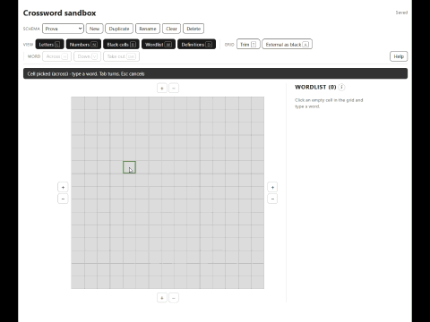

# Enigmister



Enigmister is an application to lay out crosswords by hand. You type words straight into a grid, then drag and turn them, write clues and keep several named layouts.

It is pure Python (3.8 or newer) with no dependencies. A small local server hosts the page and saves your work.

## Quick start

```bash
git clone https://github.com/rusiano/enigmister.git
cd enigmister
./enigmister                    # opens the sandbox in your browser
```

Your schemas and clues are saved in `schemas.json`, which is git-ignored, so they stay on your machine. Use `./enigmister --store other.json` to keep them in another file.

You can also install it as a package:

```bash
pip install -e .
enigmister --store schemas.json       # or: python -m enigmister.visualize
```

The server runs on `127.0.0.1:8000` (change it with `--port`). Press Ctrl+C to stop it. Without `--store`, the schemas are kept in the browser's `localStorage`.

## Using the sandbox

- Click an empty cell and type a word. **Tab** turns it and **Enter** keeps it.
- Drag a word or move it with the arrow keys. Press **H** / **V** to turn it across or down, **Del** to take it out and **Esc** to deselect it.
- The sidebar lists the words in the current schema. Click one to select it, or × to take it out of the schema.
- Press **B** to paint black cells. The +/− buttons around the grid add or remove rows and columns.
- **L**, **N**, **W** and **D** show or hide the letters, the numbers, the word list and the definitions (also in the toolbar's View group). Click a word in the definitions to write its clue.
- Keep several named schemas with New, Duplicate, Rename and Delete.

Every word gets a black cell at each end. Black cells that are walled in by letters are drawn black. Empty cells the grid edge can reach through shared sides without crossing a letter are drawn light grey, as outside the puzzle; the ones touching a letter by a side are a bit darker, as they delimit a word. The status line counts the black cells.

The Help popover in the toolbar lists every shortcut.

## Development

```bash
pip install -e ".[dev]"
python -m pytest tests/
python -m unittest tests.test_visualize    # without pytest
```

Run the tests from the repository root, because they import `src.enigmister`.
